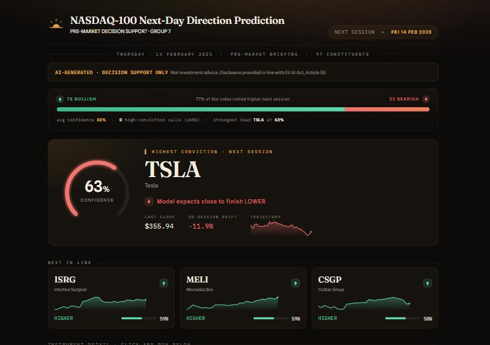
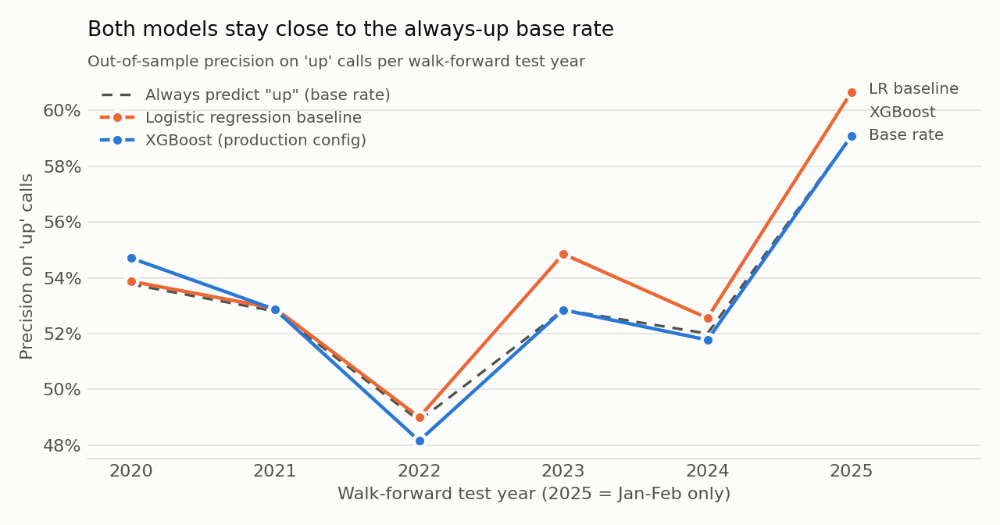

# NASDAQ-100 Next-Day Direction Predictor

[](https://github.com/FlorisSnelders/nasdaq-100-predictor/actions/workflows/tests.yml)

For each of the 100 stocks in the NASDAQ-100, this project predicts whether tomorrow's closing price will be higher than today's. It downloads ten years of daily prices and market-wide indicators, turns them into features that only use information available at the time, tests the models the way they would be used in practice (always training on the past and predicting a later year), and shows the daily signals in a Streamlit dashboard.

> Breda University of Applied Sciences, Data Science & AI (year 1) group project. This is a cleaned-up portfolio version of a BUas group project; code was lightly refactored (renaming, translated docstrings) for readability.



## Results

Daily stock direction is close to a coin flip, so the honest headline is that the models are only marginally better than the simplest possible rule: on the days they call "up", they are right about 53-54% of the time, and always predicting "up" scores about 53% too. The value of the project is in the pipeline and in validating it without leaking future information, not in a market-beating edge.

Out-of-sample results, expanding-window walk-forward validation, test years 2020-2025 (2025 = January-February), 5-trading-day embargo between train, validation and test:

| Model | Precision on "up" (mean ± std over 6 test years) | Accuracy | F1 |
|---|---|---|---|
| Always predict "up" (base rate) | 0.532 ± 0.033 | – | – |
| Logistic regression, 18 features (baseline) | 0.540 ± 0.038 | 0.530 | 0.639 |
| XGBoost with per-fold feature selection + Optuna tuning | 0.537 ± 0.034 | 0.525 | 0.610 |
| **XGBoost, deployed configuration** (3 features: `return_1d`, `vix_close`, `vix_change_1d`) | **0.532 ± 0.036** | 0.528 | 0.672 |
| LSTM on 30-day sequences, 4 test years 2021-2024 | 0.518 ± 0.022 | 0.510 | 0.602 |
| LSTM + class-weighted loss + tuned decision threshold | 0.554 ± 0.071 | 0.487 | 0.316 |



Where the numbers come from:

- All numbers are from the notebooks in `notebooks/`, run on the original course dataset (2015-02-17 to 2025-02-13, 100 stocks). After restructuring, the XGBoost notebook was re-run on that dataset and reproduced every reported number exactly.
- That dataset can't be redistributed, so `scripts/download_data.py` rebuilds it from Yahoo Finance and FRED (see [data/README.md](data/README.md)). On the rebuilt data, which has 97 stocks because three are no longer listed, the deployed XGBoost configuration scores 0.533 precision, the logistic-regression baseline 0.540 and the base rate 0.533.
- The LSTM rows are from the original LSTM run. Re-running it through the refactored data loader gives 0.519 for the base LSTM and 0.601 ± 0.119 for the tuned one; the tuned version is unstable across years (one fold makes almost no "up" calls).

Detailed per-fold metrics are in `results/metrics/`, and the model card is in [docs/model_card.md](docs/model_card.md).

## How it works

1. **Ingest:** daily OHLCV per stock (Yahoo Finance) plus the VIX volatility index and the 10-year Treasury yield (FRED), aligned to the official NASDAQ trading calendar.
2. **Clean and validate:** calendar filtering, de-duplication, OHLC consistency checks and a validation layer that stops the pipeline on bad data (nulls, duplicates, future dates, negative prices, row-count drops). Days before a gap in the data get their label invalidated.
3. **Store:** a SQLite database with four tables (`cleaned_prices`, `features`, `macro_indicators`, `predictions`); schema and benchmarks in [docs/storage.md](docs/storage.md).
4. **Features:** 14 technical indicators per stock (returns, moving-average ratios, MACD, RSI, stochastic %K, ATR, Bollinger %B, volume and OBV signals) and 4 macro features. Each indicator uses only past and current data, and unit tests check warm-up lengths and the absence of leakage.
5. **Model:** walk-forward folds by calendar year. Correlation pruning uses the training data only, while permutation importance and Optuna tuning use only the validation year, so each test year is scored exactly once. One configuration is then frozen into `models/prod_model_training_xgboost.joblib`.
6. **Serve:** daily jobs in `src/jobs/` append new data and score the newest day, and a Streamlit dashboard shows the up/down call and confidence per stock, with an AI-disclosure notice (EU AI Act Art. 50).

## Repository structure

```
├── notebooks/
│   ├── 01_eda.ipynb                  exploratory analysis of the price data
│   ├── 02_pipeline_validation.ipynb  the data-validation layer catching corrupted inputs
│   ├── 03_xgboost_model.ipynb        team model: walk-forward XGBoost, tuning, error analysis
│   └── 04_lstm_bakeoff.ipynb         LSTM sequence model compared with the same folds
├── src/                pipeline, features, storage, evaluation, LSTM, jobs/, dashboard/, explainability/
├── scripts/            download_data.py, build_database.py
├── models/             trained production XGBoost bundle
├── results/            figures and per-fold metrics (JSON)
├── tests/              pytest suite
├── config/             ticker lists
├── docs/               model card, storage/schema notes
└── data/               empty; see data/README.md
```

## Tech stack

Python 3.11-3.13 · pandas · NumPy · scikit-learn · XGBoost · Optuna · SHAP · PyTorch (LSTM) · SQLite · yfinance · FRED · pandas-market-calendars · Matplotlib / seaborn · Streamlit · pytest + pytest-cov · GitHub Actions · Docker / Docker Compose · Poetry

In the original project, the pipeline and dashboard ran in Docker: Docker Compose started one container that ran the data pipeline and a second that served the Streamlit dashboard on port 8501, both sharing the same SQLite database through a mounted volume. Dependencies were managed with Poetry. This portfolio version uses a plain `requirements.txt` and leaves the Docker setup out.

## How to run

```bash
git clone https://github.com/FlorisSnelders/nasdaq-100-predictor.git
cd nasdaq-100-predictor
python -m venv .venv
.venv\Scripts\activate            # Windows  (macOS/Linux: source .venv/bin/activate)
pip install -r requirements.txt   # on Linux, install CPU-only torch first to save space:
                                  # pip install torch --index-url https://download.pytorch.org/whl/cpu

python scripts/download_data.py   # public prices + macro data into data/raw/ (~1 min)
python scripts/build_database.py  # builds data/nasdaq100.db and scores the newest day
streamlit run src/dashboard/app.py
```

- Notebooks: `jupyter nbconvert --to notebook --execute notebooks/03_xgboost_model.ipynb`, or open them in Jupyter or VS Code. The XGBoost notebook takes a few minutes; set `N_TRIALS=5` for a quick run.
- Tests: `pytest --cov=src` (246 tests; they use synthetic data and need no download).
- The dashboard falls back to clearly labelled demo data if the database has not been built yet.

## My contribution

My focus in the team was modelling experiments, data exploration and code quality:

- **LSTM sequence model** (`src/lstm_model.py`, `notebooks/04_lstm_bakeoff.ipynb`): I built the team's deep-learning entry for the model bake-off. It's a one-layer LSTM that reads 30-day windows of the shared 17-feature set. To keep it comparable with the tree models, I reused the shared walk-forward folds and 5-day embargo. That meant assigning whole sequences to folds by their last day, so no window crosses a train/test boundary, and fitting feature scaling on the training fold only. The first version only matched the always-up baseline (precision 0.518 vs 0.517). The convergence curves showed it overfitting after the first epoch, so for a second iteration I added a class-weighted loss and a decision threshold tuned on the validation year. That raised precision to 0.554, at the cost of recall. My conclusion was that on this low-signal tabular data, gradient-boosted trees were the better choice.
- **Tests and CI** (`tests/test_lstm_pipeline.py`, `.github/workflows/tests.yml`): I wrote reproducibility tests for the LSTM pipeline and set up GitHub Actions to run the full pytest suite on every pull request.
- **Exploratory data analysis** (`notebooks/01_eda.ipynb`, `results/figures/eda/`): per-ticker descriptive statistics and the overview figures for price series, return distribution, missing trading days and class balance, for both the daily and the minute-level data.
- **Tooling and workflow:** I added PyTorch and pytest-cov to the project's Poetry dependencies, ran the test-coverage report, and worked through feature branches and pull requests. I also ran the pipeline and the Streamlit dashboard with the team's Docker Compose setup.

**Skills:** Python, pandas, NumPy, PyTorch · time-series validation (walk-forward splits, embargo, preventing look-ahead leakage) · imbalanced classification (class-weighted loss, threshold tuning, precision/recall trade-offs) · exploratory data analysis and data-quality checks · pytest, pytest-cov, GitHub Actions CI · running a Docker Compose setup · Git and GitHub collaboration, Poetry · teamwork in a five-person project

## Credits

Group project with Lucas, Ali, Yara and Roef. The XGBoost model notebook (`notebooks/03_xgboost_model.ipynb`) is the work of Roef; the data pipeline, storage layer, validation, dashboard and tests were built by the team.

Not investment advice: the model is a decision-support experiment and shows only a very small edge over a naive baseline.
